<div align="center">

# 🛡️ Yukti

### Sovereign Industrial AI Workbench

**Scattered plant knowledge → an authorized, traceable decision flow.**<br>
Self-hosted · air-gapped · runs on the plant's own GPU server · nothing leaves the premises

[](docs/CHANGELOG.md)
[](docs/DEPLOYMENT.md)
[](#-get-started)
[](docs/SECURITY_MODEL.md)
[](docs/USER_GUIDE.md)
[](#-team)
[](https://github.com/Juhilhere/Yukti/actions/workflows/ci.yml)

<br>

[**⬇️ Download for Windows**](https://github.com/Juhilhere/Yukti/releases/latest/download/Yukti-Setup.exe) &nbsp;·&nbsp;
[**🍎 Download for Mac**](https://github.com/Juhilhere/Yukti/releases/latest/download/Yukti-macOS-arm64.dmg) &nbsp;·&nbsp;
[**🌐 Try it — yukti.cypherion.tech**](https://yukti.cypherion.tech) &nbsp;·&nbsp;
[**📖 Docs**](#-documentation)

</div>

<br>

| ⚡ **~1 ms** | 🚀 **44–58 tok/s** | 🌏 **3 languages** | 🔒 **0 bytes out** |
|:---:|:---:|:---:|:---:|
| Laya routes a request<br>before any LLM call | Gemma 3 4B on a<br>6 GB laptop GPU | English · हिंदी · ಕನ್ನಡ<br>with offline speech | Offline guard blocks<br>and counts egress |

> [!NOTE]
> Team UniMinds is **not affiliated with MRPL**. MRPL facts in Yukti are public information with source links.
> The plant documents shipped with Yukti are **EXAMPLES written by Team UniMinds**, watermarked and badged in the UI.

---

**📑 Contents** · [The problem](#-the-problem) · [The answer](#-the-answer) · [End to end](#-yukti-end-to-end) · [Features](#-features) ·
[Architecture](#%EF%B8%8F-architecture) · [Why it holds up](#-why-it-holds-up) · [Performance](#-performance-measured) ·
[Get started](#-get-started) · [Roles](#-roles) · [Security](#%EF%B8%8F-security) · [Documentation](#-documentation) ·
[Roadmap](#%EF%B8%8F-roadmap) · [Team](#-team)

## 🚨 The problem

> **02:15 AM — pump A2 trips.** The electrician needs ratings, failure history, open work orders, wiring, isolation steps
> and the approved troubleshooting procedure. Now.

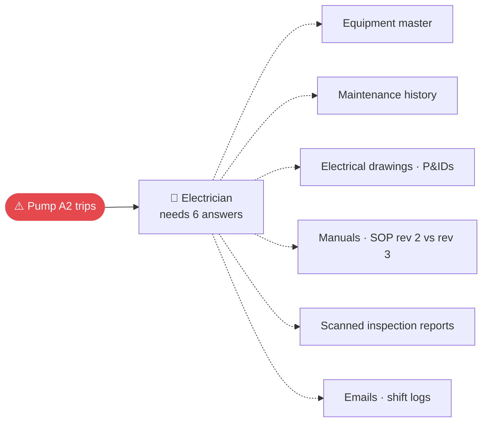

Structured records, PDFs, old scans, **conflicting revisions** — and **cloud AI is off-limits** for P&IDs and financials.
So people search manually, or paste confidential data into public tools.

## 💡 The answer

**Yukti** is a local, role-aware operating layer that connects the plant's **knowledge, people, workflows and decisions** —
without sending confidential information outside the organisation.

| 🧭 Model auto-selection | 🤖 Agentic, multimodal work | 🛡️ Sovereign & governed |
|---|---|---|
| **Laya** (ONNX, ~1 ms) returns typed decisions: intent, department, urgency, worker | Plans multi-step work with local tools: files, spreadsheets, search, **sandboxed code** | Runs on the plant's own GPU server, **air-gapped** |
| A **durable queue** hands each task to the right specialist | Scans, handwriting, drawings and photos go through **OCR + VLM** | An **ABAC policy engine** decides access — never the LLM |
| New open-weight models plug in without a redesign | Delivers **approval notes, Word / PowerPoint / Excel, calculations with steps** | **SHA-256 hash-chained audit** of every action |

## 🔄 Yukti, end to end

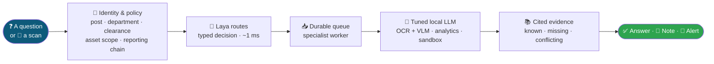

### 🔐 Who may know what

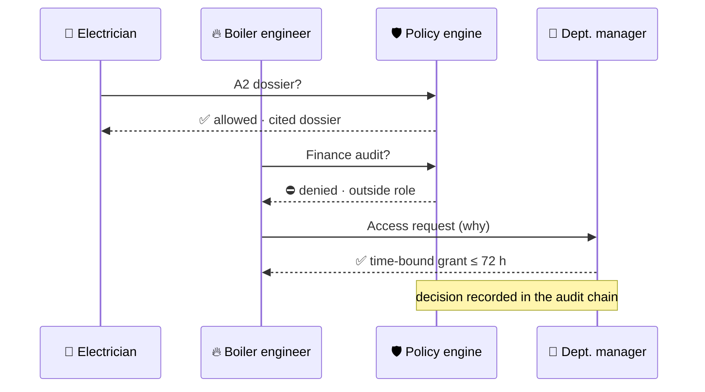

### 🧾 Every answer shows its evidence

| Field | Example |
|---|---|
| Source | `SOP-EL-014` |
| Revision | rev 3 · CURRENT |
| Page / record | p.2 · `A2_WorkOrders!34` |
| Timestamp | 2026-09-29 |
| Confidence | 0.84 |
| Status | 🟢 KNOWN · ⚪ MISSING · 🟠 CONFLICTING |
| Found by | `bm25` `tags` `graph` `vector` |

*Not merely an answer — an answer the right person is allowed to trust.*

## ✨ Features

| | Feature | In one line |
|:---:|---|---|
| 🧭 | **Laya + work queue** | Small decision model picks the worker: policy · small LLM · OCR + VLM · analytics · 27B reasoning · coder · workflow |
| 📚 | **Hybrid retrieval** | BM25 + asset tags + metadata + knowledge graph + optional BGE-M3 vectors — all behind the policy check |
| 🧰 | **Agentic workbench** | Approval notes, Word, PowerPoint, Excel, calculations with every step, code in a no-network sandbox |
| 🧾 | **Scan → finding** | OCR + VLM → verify vs asset master → human review → finding → approval note → approver lane |
| ✅ | **Approver lanes** | Electrical · mechanical · HSE · procurement · finance · management, with acknowledgement, escalation, follow-up |
| 🏷️ | **Asset ledger** | Vendor, serial, location, owner, certificate, interval, warranty, expiry — alerts before anything lapses |
| 📈 | **Production intelligence** | Demand forecast + HiGHS optimizer → scenario card: proposed change, expected value, alternatives |
| ⚙️ | **Performance Engine** | CUDA/Vulkan auto-pick, VRAM auto-fit, q8_0 KV cache, hot KV slots (TTL + LRU), speculative decoding, validated profiles |
| 📷 | **Ask with a photo** | Reads tag plates and stencils offline, matches the asset register, points out rust and leaks *(add-on)* |
| 🎙️ | **Speak instead of typing** | Offline speech in English, Hindi, Kannada — whisper.cpp + AI4Bharat IndicWhisper *(add-on)* |
| 🧪 | **Isolated research layer** | Experimental models with their own guardrails — no documents, tools or approvals |
| 🌐 | **Knowledge base** | Contacts and approved points of contact, company history, digitised old records, MRPL public data (140 sources) |

### 📸 Screenshots

| | |
|---|---|
| 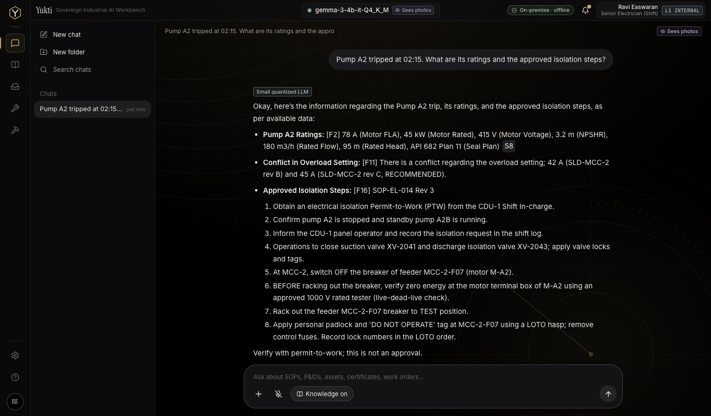<br>**Cited answer with facts and policy decisions** | 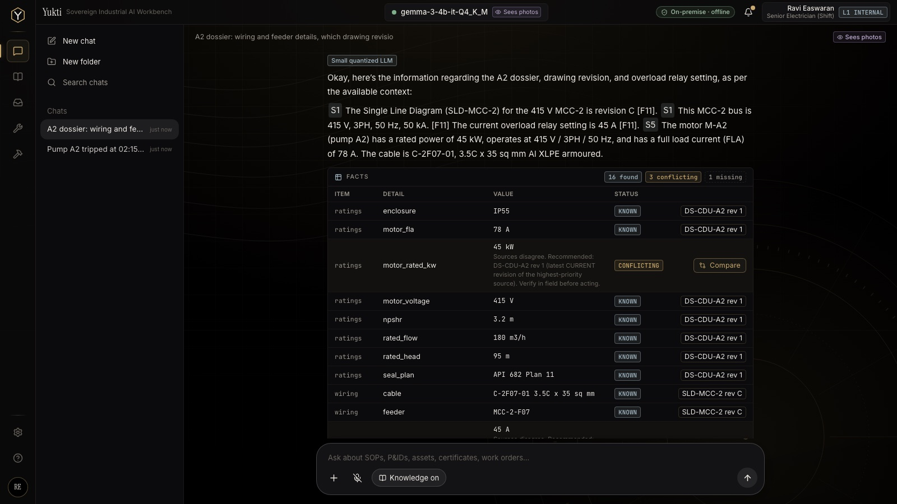<br>**Conflicting sources with a recommendation** |
| 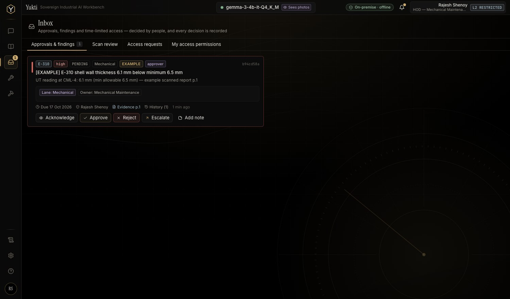<br>**Inbox: access requests and findings** | 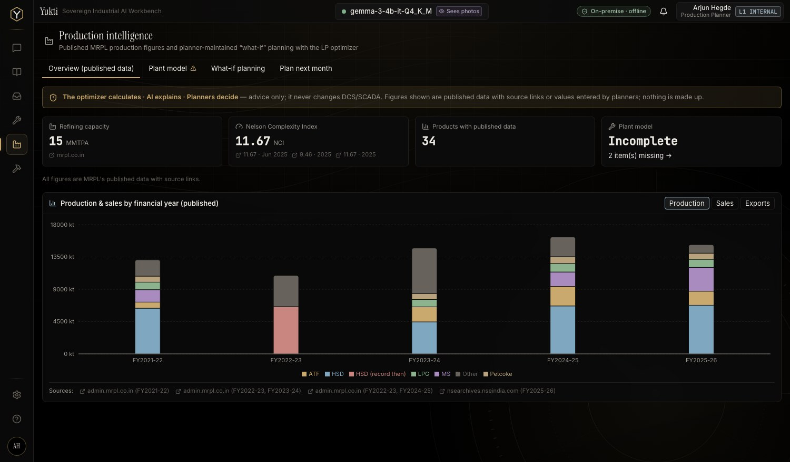<br>**Production intelligence** |
| 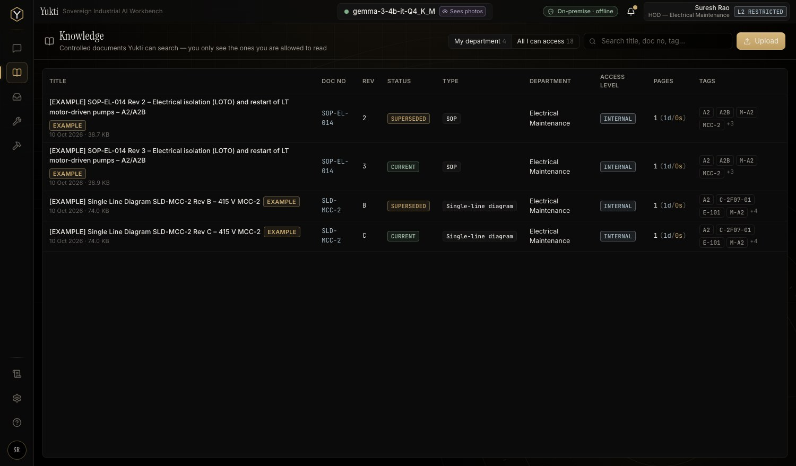<br>**Knowledge: HOD uploads for own department** | 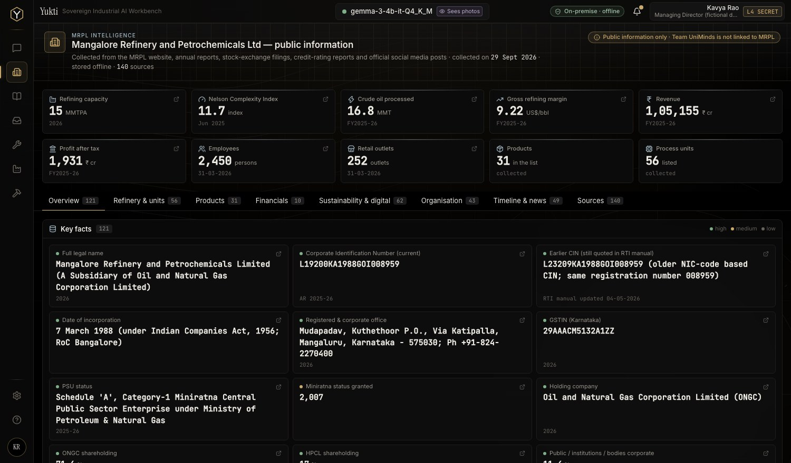<br>**MRPL public intelligence with sources** |
| 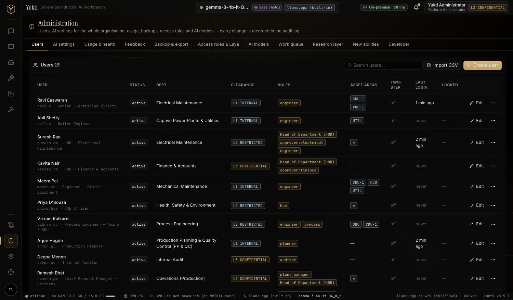<br>**Admin: users, roles, MFA** | 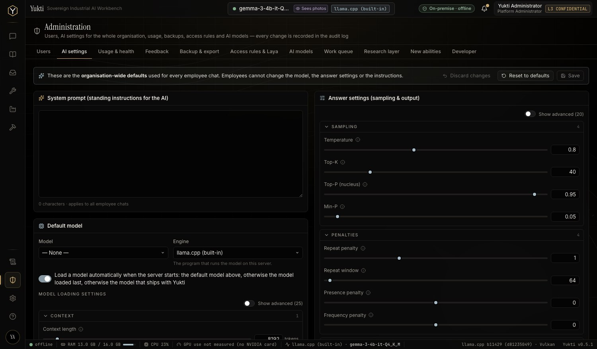<br>**Admin: organisation-wide AI settings** |
| 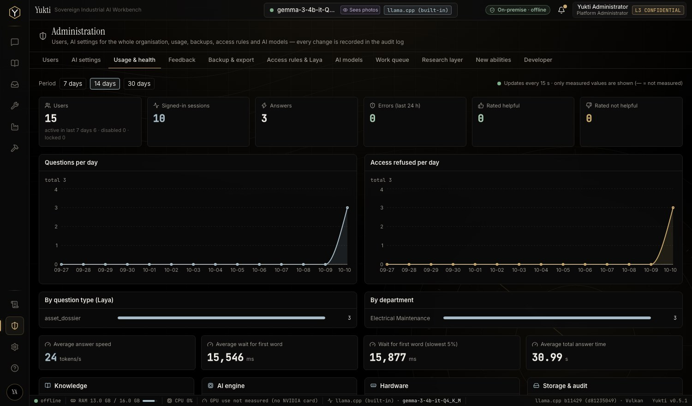<br>**Admin: measured usage and health** | 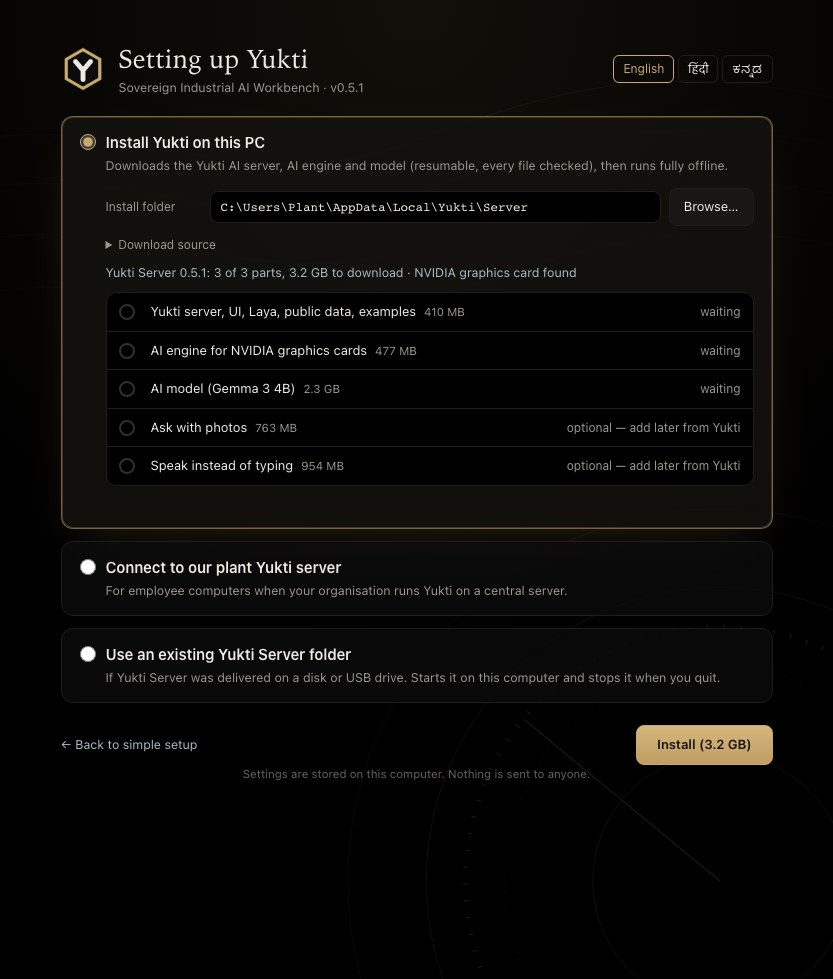<br>**Desktop app setup** |


### 🧾 Scan → finding → approval

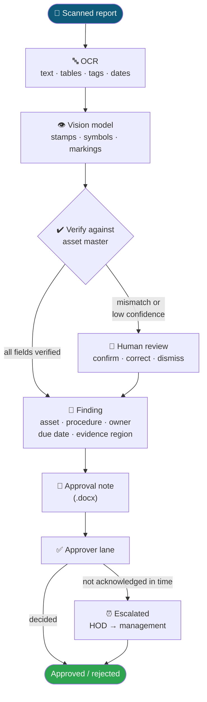

> *A forgotten scan becomes an owned workflow with a deadline.*

### 📈 Production intelligence

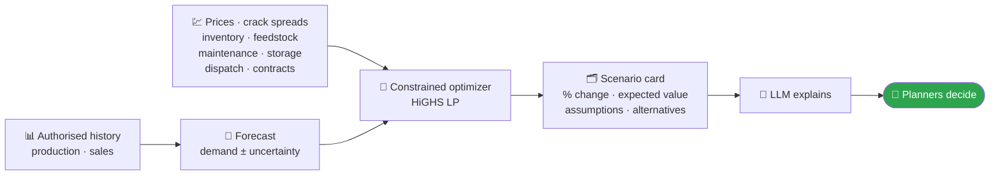

> 🔒 **Yukti never changes DCS or SCADA setpoints.** The optimizer calculates, the LLM explains, planners decide.

## 🏗️ Architecture

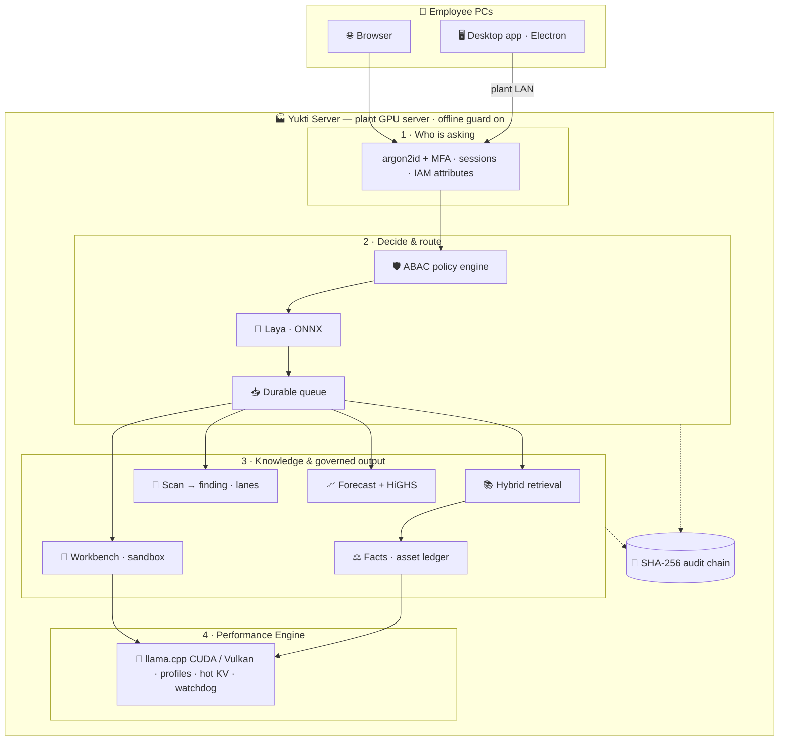

### 🔁 Project lifecycle

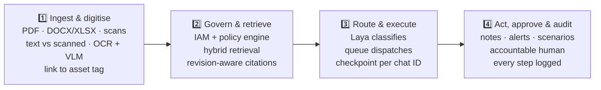


### 🧰 Technology stack

| Layer | Stack |
|---|---|
| 🐍 Language & app | Python · FastAPI · React + Vite · Electron |
| 🧠 Local inference | llama.cpp · ONNX Runtime · AI4Bharat ASR · CUDA / Vulkan |
| 🤖 Models & solvers | Gemma 3 4B · RapidOCR · Laya · HiGHS LP · *optional:* 27B-class reasoning, BGE-M3 |
| 🔐 Data & security | SQLite FTS5 · ABAC policy · argon2id + MFA · SHA-256 audit |


Full design: **[docs/ARCHITECTURE.md](docs/ARCHITECTURE.md)** · research behind it: **[docs/REFERENCES.md](docs/REFERENCES.md)**

## 🧱 Why it holds up

| 🛡️ Policy, not prompts | 🧭 Small model decides first |
|---|---|
| Authorization comes from the host policy engine, so **the LLM cannot grant itself permission**. A genuine need goes to the department manager for time-bound, recorded access. | Guardrail denials, off-topic and need-to-know questions are answered **without calling the LLM**. The prompt is fitted to the context window: old turns and the least relevant documents go first; facts and the question always stay. |

| | ☁️ Cloud AI assistants | 🛡️ Yukti workbench |
|---|:---:|:---:|
| Data | must leave the plant | **on-premise, air-gapped** |
| Cost | pay per token | **one-time hardware, tuned to the local GPU** |
| Serving | generic, no tuning | **q8_0 KV cache · speculative decoding · profiles** |
| Trust | fluent answer, no source | **cited: known · missing · conflicting** |

Risks, rollout and viability → **[docs/FEASIBILITY.md](docs/FEASIBILITY.md)**

## ⚡ Performance (measured)

RTX 4050 laptop GPU, 6 GB:

| What | Measured |
|---|---|
| 🚀 Gemma 3 4B generation (llama.cpp CUDA) | **44–58 tok/s** |
| 🧠 Gemma 3 4B + Whisper turbo together | **5.1 of 6 GB** VRAM |
| 📷 Photo question (OCR + model) | 4–10 s |
| 🎙️ Speech to text, Whisper turbo on GPU | 0.3–0.4 s for a 4 s question |
| 🧭 Laya routing | ~1 ms |

| Backend · Gemma 2 2B Q8_0 | Generation | First token |
|---|---|---|
| llama.cpp **CUDA 12.4** | **51.7 tok/s** (3.9× CPU) | **0.2 s** |
| llama.cpp Vulkan | 50.8 tok/s | — |
| CPU only | 13.4 tok/s | — |

> No cluster, no cloud. Larger models (e.g. a quantized 27B-class reasoning model) use Performance Engine profiles that
> administrators **validate on their own server**; the dashboard shows only values measured there.

## 🚀 Get started

### 👷 Users — one download, one double-click

**🪟 Windows 10 / 11**

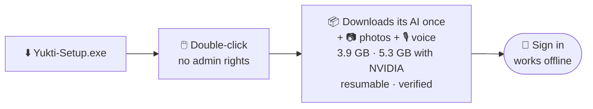

- Windows SmartScreen? **More info → Run anyway** (installers are not code-signed yet).
- **📷 Photos** and **🎙️ voice** come with the first install; an admin can remove either from the home screen.
- No internet? Copy the offline package (`ops\release-site.ps1`) by USB.

**🍎 Mac (Apple silicon, macOS 13.3+)**

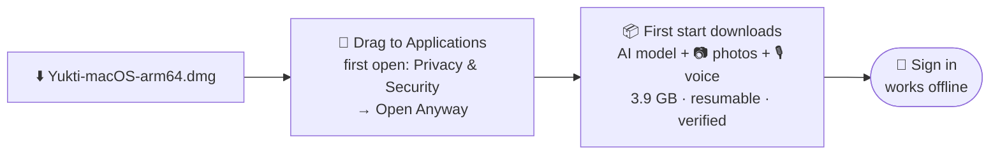

- Runs on the Mac's own graphics chip (Metal): llama.cpp for answers, whisper.cpp for voice, both inside the app.
- Not notarized yet: macOS asks once, **System Settings → Privacy & Security → Open Anyway**.

→ [User Guide](docs/USER_GUIDE.md)


### 🛠️ Administrators — run the server

The self-contained **Yukti Server** package ships `yukti-server.exe`, llama.cpp (CUDA 12.4 + Vulkan), Gemma 3 4B with its
image module, whisper.cpp, a pre-trained Laya, the UI and the data — no Python, Ollama or vLLM needed (but usable if present).

| Goal | Run |
|---|---|
| This PC only | `Yukti.exe` (or `server\Start Yukti Server.cmd`) |
| Serve the plant LAN | `server\Start Yukti Server (Plant LAN).cmd` — allow TCP 8000 for the plant subnet only |
| Publish the download | `ops\build-release.ps1` → `ops\release-site.ps1` · Mac: `ops/build-mac.sh` → `Yukti-macOS-arm64.dmg` |

Optional models ([MODELS.txt](ops/package/MODELS.txt)): 27B-class reasoning · BGE-M3 vectors · AI4Bharat IndicWhisper · research model.

→ [Deployment](docs/DEPLOYMENT.md) · [Admin Guide](docs/ADMIN_GUIDE.md)


### 👩‍💻 Developers

Requires [uv](https://docs.astral.sh/uv/) + Python 3.12 and Node 22.

```powershell
cd backend; uv sync                       # backend
cd ..\web; npm ci; npm run build          # UI (or: npm run dev on :5173)
cd ..; .\ops\start.ps1                    # API + UI on http://127.0.0.1:8000
cd desktop; npm ci; npm start             # desktop client (npm run dist → Yukti-Setup.exe)
```

| Tests | Command | Needs |
|---|---|---|
| 🧪 Unit / API | `cd backend; uv run pytest` | nothing (no GPU) |
| 🔁 Live end-to-end (86 checks) | `uv run python tests/live/e2e_live.py` | running server + model |
| 🧰 Live workbench | `uv run python tests/live/workbench_live.py` | running server + vision model |
| 💥 Stress / fault injection | `uv run python tests/live/stress_live.py` | running server |
| 🌐 Web | `cd web; npm run build` | Node 22 |

First start seeds demo employees, MRPL public data and the example documents (~30 s). Reset: delete `data\store\`.
→ [Contributing](docs/CONTRIBUTING.md) · [API](docs/API.md)


## 👥 Roles

| Role | Can |
|---|---|
| 👷 **Employee** | Cited chat over what they may see · workbench · request access · inbox |
| 👔 **Head of Department** | + own department's documents · approve access · findings · scan review · ledger |
| ✅ **Approver lanes** | Decide their lane: electrical · mechanical · HSE · procurement · finance · management |
| 🏭 **Plant manager** | Approvals · escalations · audit · work queue · production |
| 🏛️ **Top management** | The only role with company-level information (finances, strategy) |
| 📈 **Planner** | Plant model · forecast · plan scenarios |
| 📦 **Stores** | Register purchased and installed items in the ledger |
| 🔍 **Auditor** | Audit log · chain verification · export |
| 🧪 **Researcher** | Isolated research layer only |
| ⚙️ **Administrator** | All LLM configuration · users · backups · policies — but **no plant documents** |

## 🛡️ Security

| | |
|---|---|
| 🚫 **LLM never decides access** | Host policy runs before retrieval and before every tool call — deny-overrides, default deny, fail closed |
| 🔌 **Offline guard** | Blocks and counts outbound connections: proof of no external calls |
| 🔗 **Tamper-evident audit** | Logins, denials, retrievals, tool calls, answers, approvals — hash-chained |
| 🎛️ **Advisory only** | No tool can write to DCS/SCADA; safety steps need accountable humans |
| 📦 **Sandbox & research isolation** | Code runs without network or system access; experimental models stay isolated |

→ [Security Model](docs/SECURITY_MODEL.md) · report a vulnerability: [docs/SECURITY.md](docs/SECURITY.md) · bugs: **juhilprogramming@gmail.com**

## 📚 Documentation

| 👷 Using Yukti | 🛠️ Running Yukti | 🧠 Understanding Yukti | 📋 Project |
|---|---|---|---|
| [User Guide](docs/USER_GUIDE.md) | [Deployment](docs/DEPLOYMENT.md) | [Architecture](docs/ARCHITECTURE.md) | [Changelog](docs/CHANGELOG.md) |
| | [Admin Guide](docs/ADMIN_GUIDE.md) | [Security Model](docs/SECURITY_MODEL.md) | [Contributing](docs/CONTRIBUTING.md) |
| | [API](docs/API.md) · [API v2+](docs/API_v2.md) | [Feasibility & impact](docs/FEASIBILITY.md) | [Security policy](docs/SECURITY.md) |
| | | [Research & references](docs/REFERENCES.md) | [Third-party notices](docs/THIRD_PARTY_NOTICES.md) |

## 🗺️ Roadmap

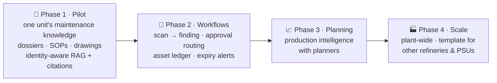

### 🚧 Not done yet

- 🔏 Code-signed installers (SmartScreen warns today)
- 🔐 Certificate management — HTTPS works with `--tls-cert`/`--tls-key`; issuing and renewal is left to the plant PKI
- 🛡️ A refinery-specific guard model — studied only in the isolated research layer for now
- 🔗 Read-first connectors to DMS, CMMS and SAP
- 🐧 A Linux server package
- 📏 Evaluation on real plant documents and calibration of Laya on labelled refinery workflows


### 🧪 Real vs example data

| ✅ Real (measured or sourced) | 🧪 Example (by Team UniMinds, badged) | ⛔ Not included (from the plant) |
|---|---|---|
| All software behaviour, settings, tok/s, audit hashes, policy decisions · MRPL public data from 140 sources | 18 plant documents (datasheet, SOP and drawing revisions, troubleshooting guide, E-310 and PSV-118 scans, 1998 letter, finance audit, MSDS, manual, shift log, work orders, asset register, contacts) and the assets they describe | Yields, prices, demand history and contracts (the planner enters them) · the real asset register · real documents · the HR directory |


## 👥 Team

<div align="center">

**Team UniMinds** · Team ID 152431 · Smart India Hackathon 2026

**SIH26117** — *Sovereign On-Premise Agentic AI Workbench using Open-Weight Multimodal LLMs for Confidential Industrial Work*<br>
Theme: Smart Automation · Category: Software

| Juhil Modi (lead) | Saswata Das | Harshit Tiwari | Rohan Jangam | Ritesh Prajapati | Sanskriti |
|:---:|:---:|:---:|:---:|:---:|:---:|

</div>

---

<sub>Copyright © 2026 Team UniMinds. Proprietary, under the [Yukti Proprietary Licence](LICENSE): the IP stays with Team UniMinds
(per SIH rules), MRPL and the Ministry of Petroleum and Natural Gas get free lifetime use, the SIH organisers may evaluate it,
and anyone else needs our written permission. See [NOTICE](NOTICE) and [third-party notices](docs/THIRD_PARTY_NOTICES.md).</sub>
